# Designing a Full-Stack Quality Engineering Platform for Cloud-Native Event-Driven Distributed Systems

## A Reference Architecture for End-to-End Validation Across UI, API, Security, Data, Messaging, Storage, and CI/CD Layers

**Author:** Subramanian Meenakshi  
**Repository:** [FullStack-Automation-Framework](https://github.com/Subramanian-Meenakshi/FullStack-Automation-Framework)  
**Companion artifacts:** [Allure report](https://subramanian-meenakshi.github.io/FullStack-Automation-Framework/allure/) · [CI pipeline](https://github.com/Subramanian-Meenakshi/FullStack-Automation-Framework/actions) · [README](README.md)

---

## Executive Summary

Modern enterprise systems have evolved far beyond traditional web applications. A single business transaction typically traverses user interfaces, authentication services, APIs, databases, caches, event streams, object storage, audit mechanisms, and deployment pipelines.

This case study presents the design and implementation of a full-stack Quality Engineering platform built to validate an entire distributed ecosystem rather than individual application components.

The platform combines:

| Layer | Technology |
|---|---|
| Portal | React 18 + Vite 5 + Material UI 6 |
| Services | Spring Boot 3.3 (auth, employee, consumer) — Java 21 |
| Identity | JWT HS384 (access 15 min / refresh 7 days), BCrypt, RBAC |
| Data | PostgreSQL 16, Redis 7 (cache-aside, TTL 600 s) |
| Messaging | Apache Kafka 3.7.0 (KRaft), 4 topics |
| Storage | LocalStack 3.0.2 S3, AES-256-GCM encrypted snapshots |
| Tracing | `X-Correlation-ID` across UI → API → audit → Kafka → consumer → S3 |
| Automation | Playwright 1.64 (chromium), 131 tests, Allure 2.46 |
| Delivery | GitHub Actions CI (3 jobs) + CD to GHCR on `v*` tags |

**Evidence of scale:** 1 portal + 3 microservices + 5 infrastructure containers · 35-check API smoke matrix · 131 Playwright tests across 12 spec suites · Allure report published on every green run · GHCR images published at `v0.1.0`.

The objective: demonstrate how modern Quality Engineering provides confidence across business workflows, security controls, distributed transactions, event-driven architecture, data integrity, and cloud-native infrastructure — with every claim in this document backed by an automated check or a runnable script.

---

## Business Context

### The Problem

Traditional automation frameworks typically focus on a single layer of the application stack.

| Approach | Limitation |
|---|---|
| UI automation | Cannot validate backend processing |
| API automation | Cannot validate user experience |
| Database testing | Cannot validate business workflows |
| Service testing | Cannot validate end-to-end integration |
| Security testing | Usually isolated from business transactions |

As organizations adopt microservices, event-driven architectures, distributed caching, and cloud-native storage, defects increasingly occur at **integration boundaries** rather than inside individual applications.

Real defect classes this platform is built to catch:

- API request succeeds but the Kafka event is never published.
- Kafka event is published but consumer processing fails.
- Database is updated but the Redis cache stays stale.
- Business action succeeds but audit logs are not recorded.
- Data reaches storage but encryption requirements are not met.
- Authorization rules allow incorrect user access.
- Correlation ID is lost at a service boundary, making incidents untraceable.

None of these are detectable through isolated UI or API testing. The platform's core design principle follows from that: **validate the transaction, not the component.**

---

## Architecture Vision — Core Principles

1. **End-to-end business validation** — one test case may span UI, API, Postgres, Redis, Kafka, and S3.
2. **Distributed traceability** — one correlation ID links every log line, audit row, and event payload.
3. **Cloud-native portability** — containerized infrastructure, scriptable from zero on any Linux host.
4. **Security by design** — authentication, authorization, and encryption are tested layers, not afterthoughts.
5. **Observability first** — audit trail and correlation precede metrics/tracing (roadmap: OpenTelemetry).
6. **Automation as code** — every gate is a script (`infra.sh`, `restart.sh`, `smoke.sh`), runnable locally and in CI with identical commands.

---

## C4 Architecture Diagrams

### Level 1 — System Context

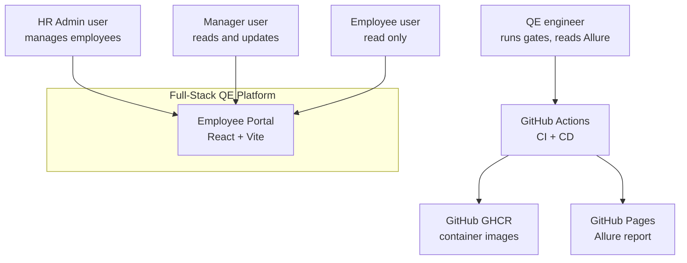

The platform is a self-contained system: users interact through the portal; engineers interact through CI. GitHub hosts the delivery artifacts (images, report); runtime hosting for a public demo remains a deliberate open item (see *Production Readiness*).

### Level 2 — Container View

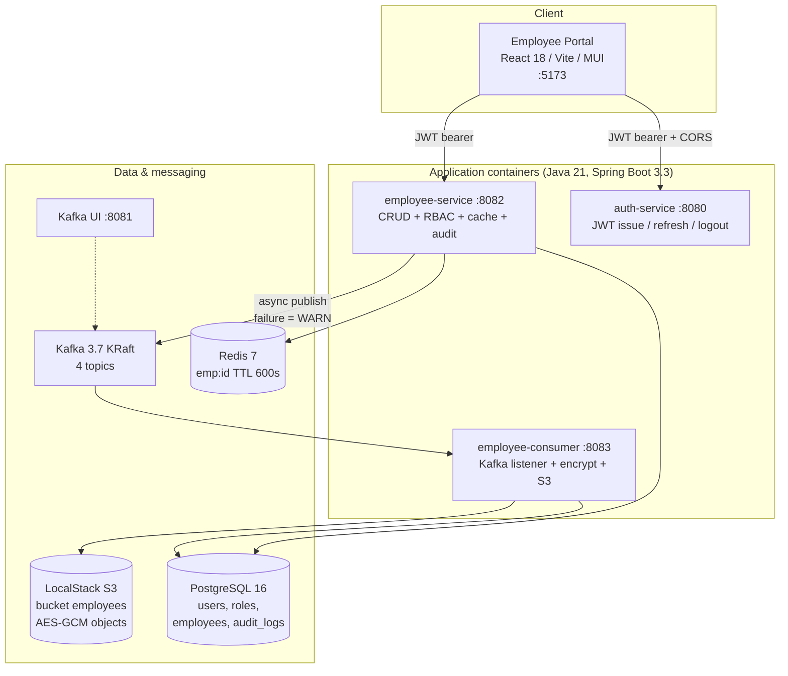

Container responsibilities:

| Container | Responsibility | State owned |
|---|---|---|
| Employee Portal | UI, session storage, role-aware navigation | localStorage tokens |
| auth-service | Login, refresh, logout; HS384 tokens; BCrypt verification | users, roles |
| employee-service | CRUD, `@PreAuthorize` RBAC, cache-aside, Kafka publish, audit writes | employees, audit_logs |
| employee-consumer | Consume 4 topics, AES-256-GCM encrypt snapshot, S3 overwrite, `system` audit rows | S3 objects |
| PostgreSQL | System of record | all relational state |
| Redis | Read-through cache, TTL eviction | `emp:{id}` |
| Kafka | Event backbone, decouples write path from storage sync | 4 topics |
| LocalStack S3 | Encrypted employee snapshots (last-writer-wins per employeeId) | `employees/{id}.json` |

### Level 3 — Component View (employee-service)

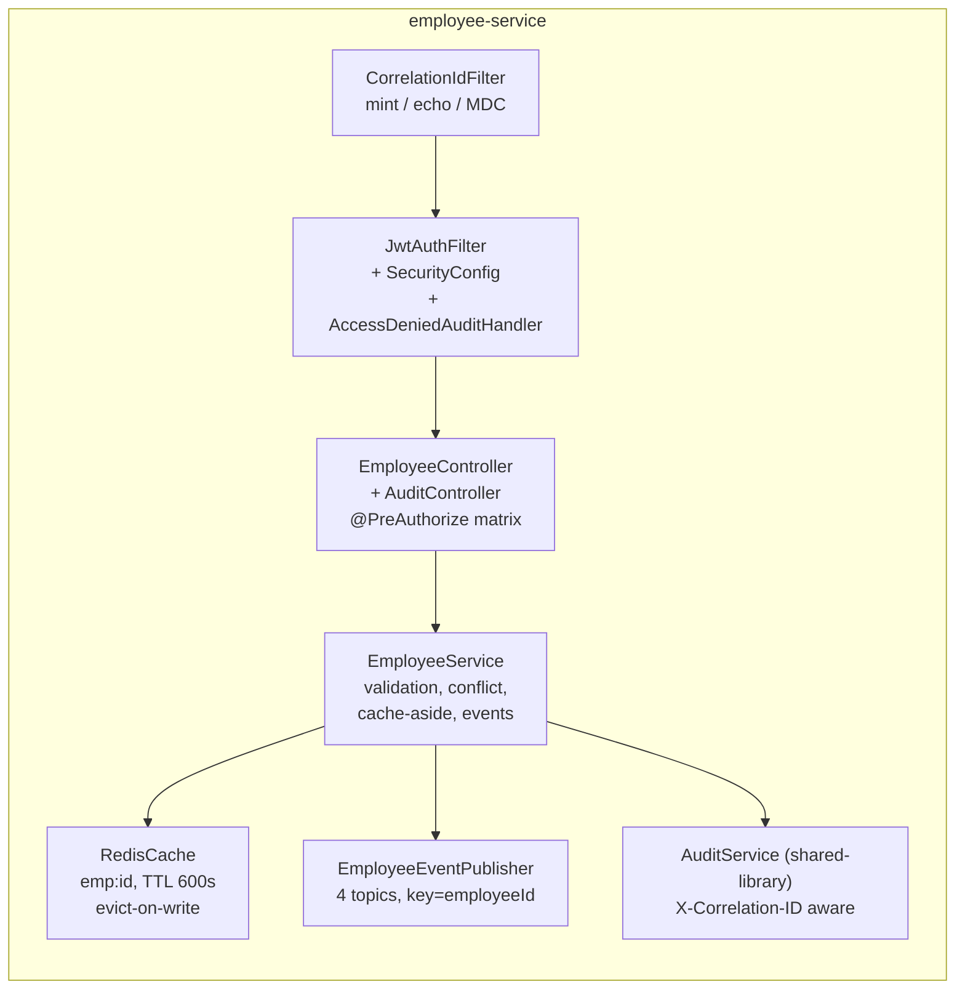

The consumer mirrors this shape: `EmployeeEventListener` (`@KafkaListener` × 4 topics) → `S3StorageService` (AES-GCM) → `AuditService` (`SUCCESS`/`FAILURE`, user `system`).

---

## Application Architecture

### Presentation Layer

- React 18, Vite 5, Material UI 6, React Router 6 (BrowserRouter).
- Responsibilities: authentication, employee management (list/details/create/edit/delete/restore), role-based navigation, protected routes, audit visibility, dashboard counts.
- Talks to services with **same-origin relative paths** (`/api/*`, `/employees*`, `/audit*`); in dev, the Vite proxy routes them to `:8080`/`:8082`, in CI tests run against the proxy — no CORS friction in the inner loop; services still allow `http://localhost:5173` and `:3000` explicitly for non-proxy callers.

### auth-service (`:8080`)

| Endpoint | Access | Notes |
|---|---|---|
| `POST /api/auth/login` | public | BCrypt verify → access (15 min) + refresh (7 days) |
| `POST /api/auth/refresh` | public | validates `type=refresh`, re-issues pair |
| `POST /api/auth/logout` | authenticated | client discards tokens |
| `GET /api/public/health` | public | CI health gate |

Token claims: `sub`, `role`, `type` (`access` | `refresh`). Algorithms other than HS384 and non-canonical base64url encodings are rejected.

### employee-service (`:8082`)

| Verb / path | Roles | Extra |
|---|---|---|
| `POST /employees` | HR_ADMIN | validation, duplicate → 409 |
| `GET /employees`, `GET /employees/{id}` | HR_ADMIN, MANAGER, EMPLOYEE | cache-aside read, publish `employee-read` |
| `PUT /employees/{id}` | HR_ADMIN, MANAGER | evict cache, publish `employee-update` |
| `DELETE /employees/{id}`, restore | HR_ADMIN | evict, publish `employee-delete` |
| `GET /audit` | HR_ADMIN, MANAGER | newest-first, cap 200 |

Defense in depth: `SecurityConfig` (authenticated by default, `/error` + `/api/public/**` permitAll) → `@PreAuthorize` method rules → UI route guards and nav gating → automation asserts the same matrix (suite B). Denials are audited by `AccessDeniedAuditHandler`; failed logins are audited as `LOGIN_FAILED`.

### employee-consumer (`:8083`)

- Single `@KafkaListener` over `employee-create`, `employee-update`, `employee-delete`, `employee-read`.
- Payload already carries the full API response snapshot — consumer encrypts and writes `employees/{employeeId}.json` (overwrite, last-writer-wins).
- Every consume writes an audit row as `system` with `SUCCESS` or `FAILURE` (malformed events become `FAILURE`, never crash the listener).
- Consumer downtime does not affect the write path: UI/API continue, events buffer in Kafka, S3 sync resumes on recovery (asserted by suite F).

---

## Security Architecture

### Authentication

- **JWT HS384** shared secret (`app.jwt.secret` identical in both services), access 15 min, refresh 7 days.
- Claim `type` enforced: refresh tokens cannot be used as access tokens (suite A).
- BCrypt password hashing; tampered/expired/alg-none tokens rejected.
- Refresh rotation issues a new pair on every refresh.

### Authorization (RBAC)

| Role | Create | Read | Update | Delete/Restore | Audit read |
|---|---|---|---|---|---|
| HR_ADMIN | ✅ | ✅ | ✅ | ✅ | ✅ |
| MANAGER | ❌ | ✅ | ✅ | ❌ | ✅ |
| EMPLOYEE | ❌ | ✅ | ❌ | ❌ | ❌ |

Enforced at four layers: UI (route guards, hidden buttons), API filter chain, service `@PreAuthorize`, and automation (suite B replays the full matrix every run).

### Encryption at rest

- Employee snapshots in S3 are **AES-256-GCM**: `iv(12) ‖ tag(16) ‖ ciphertext`, key in env `S3_DEC_KEY_B64`.
- Suite F downloads the object, decrypts it, and field-compares it against the API response and the Kafka payload.

### CORS and error handling

- Explicit allow-list: `http://localhost:5173`, `http://localhost:3000` — registered on the **security filter chain** (not only MVC), so preflight survives Spring Security.
- `/error` stays `permitAll` in every `SecurityConfig`, otherwise the container's error dispatch converts business 400s into 403s (verified by suite C).

---

## Distributed Systems Design

### Redis — cache-aside, evict-on-write

```text
read:   GET emp:{id} → hit? return : load Postgres → SET emp:{id} JSON, TTL 600s
write:  UPDATE/DELETE row → DEL emp:{id}  (never blind-SET a stale value)
```

- Corrupt cache JSON → self-heal (re-read DB, overwrite).
- Redis down → reads fall back to Postgres with a WARN; CRUD never depends on Redis availability (suite D).
- Deliberately **manual** cache-aside, not `@Cacheable`: eviction, TTL, and failure behaviour are explicit and testable line-by-line.

### Kafka — event backbone

| Topic | Key | Payload |
|---|---|---|
| `employee-create` | `employeeId` | exact API response body + `correlationId` |
| `employee-update` | `employeeId` | idem |
| `employee-delete` | `employeeId` | idem |
| `employee-read` | `employeeId` | idem (reads also sync downstream snapshots) |

- Publish is **async and non-blocking**: a Kafka outage logs WARN and leaves CRUD green (suite E negative test).
- Ordering per employee is guaranteed by key partitioning; downstream overwrite is last-writer-wins per `employeeId`.

### Correlation ID strategy

```text
any request → CorrelationIdFilter: read X-Correlation-ID or mint one
           → MDC in every log line
           → echo header on response (success AND error, including /error)
           → audit_logs.correlation_id column
           → Kafka payload.correlationId
           → consumer audit row + consumer log line
```

Suite H proves each hop: echo provided/generated, present on error responses, shared across auth + employee services, inside the Kafka payload, in the audit row, and in the consumer log.

---

## Sequence Diagrams

### Create Employee (happy path)

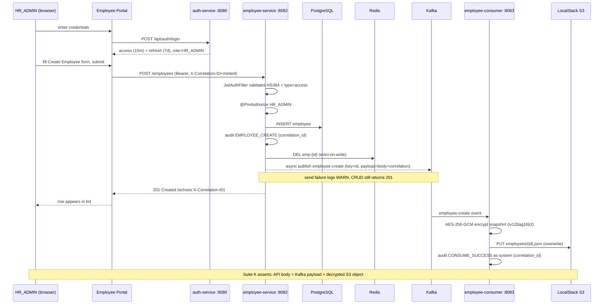

### Update Employee (role-gated, cache + sync)

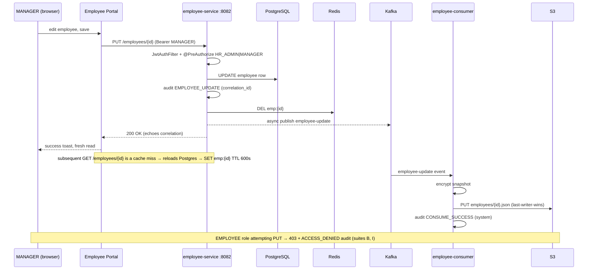

---

## Observability Architecture

### Current state — correlation IDs, logs, audit

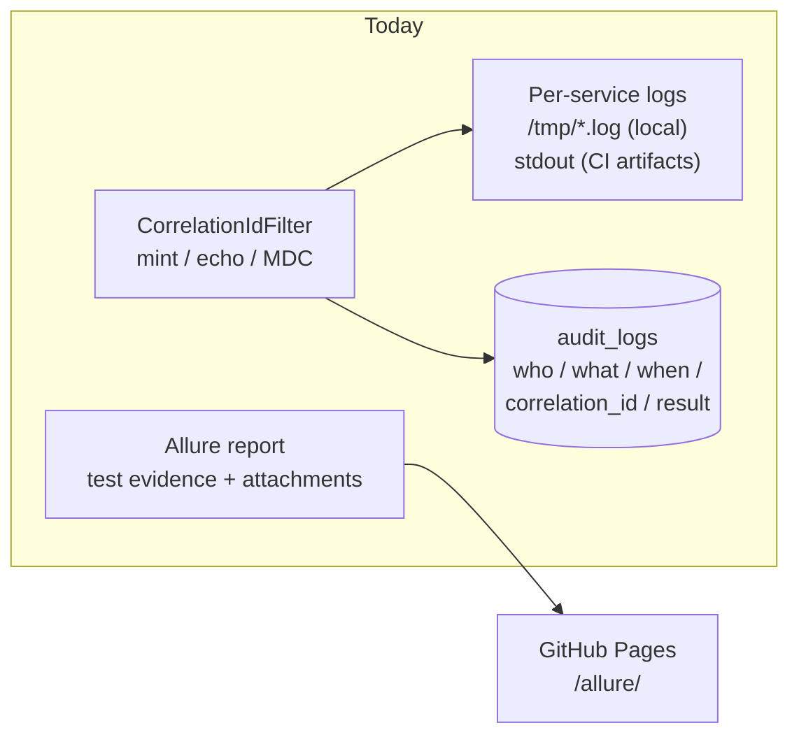

- **Logs:** one correlation ID in every line via MDC; CI stages service logs as `ci-logs` artifacts on failure.
- **Audit:** structured, queryable business trail (`LOGIN_FAILED`, `EMPLOYEE_*`, `CONSUME_*`, access denials) — this doubles as a security event log.
- **Test evidence:** Allure attachments embed API bodies, Kafka messages, and decrypted S3 payloads per test.

### Gaps (honest assessment)

No metrics, no distributed tracing, no log aggregation, no alerting. Correlation IDs are the bridge to that future: they are already the trace ID.

---

## Technology Decision Matrix

| Decision | Options considered | Choice | Rationale / evidence |
|---|---|---|---|
| E2E framework | Selenium, Cypress, WebKit matrix | **Playwright (chromium)** | Auto-waiting, first-class API request context lets one framework drive UI + API + assertions; CI-stable at 131 tests / ~9 min |
| Kafka mode | ZooKeeper, KRaft | **KRaft** | One less moving part in compose; official `apache/kafka:3.7.0` image, no ZooKeeper container |
| S3 for tests | MinIO, LocalStack, AWS | **LocalStack 3.0.2 (pinned)** | MinIO image was blocked by the corporate firewall; AWS SDK-compatible; **never bump** — newer images demand a license token (exit 55) |
| Cache pattern | `@Cacheable`, manual cache-aside | **Manual** | Explicit evict-on-write, TTL, corrupt-JSON self-heal and Redis-down fallback — each individually testable (suite D) |
| Event publish | Synchronous in transaction, transactional outbox | **Async, WARN on failure** | Availability over strict consistency; suite E proves CRUD survives Kafka outage; outbox listed on roadmap |
| Token algorithm | HS384, RS256, opaque sessions | **HS384** | Symmetric secret fits two-service demo with zero key-distribution infra; RS256/OIDC on roadmap (see Threat Model residuals) |
| Trace propagation | Spring Sleuth/Micrometer, hand-rolled header | **Hand-rolled `X-Correlation-ID`** | Zero dependency, works in shared-library filter, already proven across 6 hops; OpenTelemetry adoption planned |
| Report | Allure, built-in HTML, custom | **Allure 2.46** | Suite-level history, attachments for cross-store payloads, published to GitHub Pages per run |
| Bundler | CRA, Webpack, Vite | **Vite 5** | Instant dev server, first-class proxy config, tiny CI build (~18 s) |
| CI platform | Jenkins, GitLab CI, GitHub Actions | **GitHub Actions** | Repo-native badges, artifacts, `gh-pages` publish action, GHCR login with built-in token |
| Image registry | Docker Hub, GHCR | **GHCR** | Same token/permissions as the repo; `v*` tag scheme publishes `:vX.Y.Z` + `:latest` |
| Runtime packaging | VM deploy, K8s now, images-only | **Images now, K8s later** | 4 Dockerfiles ship in CD; cluster topology deferred until a host target exists |

---

## Non-Functional Requirements

| NFR | Target | Implemented as | Verified by |
|---|---|---|---|
| **Scalability — read path** | Absorb repeated reads without DB growth | Redis cache-aside, TTL 600 s, bounded by `db-flush` every 5th test run | Suite D (miss/hit/TTL/evict), `db-flush.sh` |
| **Scalability — write path** | Downstream sync must not block writes | Async Kafka publish, per-employee key partitioning, S3 overwrite | Suite E (`kafka paused → CRUD survives`), suite K |
| **Scalability — test data** | Suites must not grow tables without bound | `runGate.js` flush: keep 10 baseline employees + last 1000 audit rows | Gate helper + `scripts/db-flush.sh` |
| **Security — identity** | No plaintext credentials, no forged tokens | BCrypt, HS384, `type` claim, expiry, alg-none/tamper rejection | Suites A, I |
| **Security — authorization** | Least privilege per role, everywhere | 4-layer RBAC matrix (UI, filter chain, `@PreAuthorize`, tests) | Suites B, I, J (UI gating) |
| **Security — data at rest** | S3 objects unreadable without key | AES-256-GCM, key only in env `S3_DEC_KEY_B64` | Suite F (decrypt + field match) |
| **Reliability — write path** | Infra outage ≠ user outage | Kafka-down WARN path, Redis-down fallback, consumer down = UI unaffected | Suites E, D, F negative tests |
| **Reliability — data integrity** | Eventual consistency is *correct* consistency | API = Kafka = S3 three-way equality, last-writer-wins documented | Suite K |
| **Reliability — audit completeness** | Every sensitive action leaves a row | Correlated audit writes incl. failures and denials | Suites G, H, smoke matrix |
| **Reliability — delivery gates** | Broken code cannot merge green | `FAIL=0` infra gate → 35-check smoke → 131 tests → report | CI stage table below |
| **Observability** | One ID stitches a transaction together | `X-Correlation-ID` across 6 hops, echoed incl. errors | Suite H |
| **Portability** | Zero-setup local reproduction | Compose + shell scripts, env-overridable URLs, no machine paths | CI vs local identical commands |

---

## Threat Model (STRIDE)

Scope: portal → auth → employee-service → consumer → stores. Assets: credentials, JWT secret, employee PII, audit trail, S3 snapshots.

| # | Threat (STRIDE) | Scenario | Control implemented | Verified by | Residual gap |
|---|---|---|---|---|---|
| T1 | **Spoofing** — forged identity | Stolen/forged token, alg-none, wrong `type` | HS384 verification, `type=access` check, expiry, non-canonical base64url rejected, BCrypt login | Suite A (tampered/expired/alg-none/refresh-as-access) | Shared symmetric secret; no rotation (Vault/OIDC roadmap) |
| T2 | **Spoofing** — credential guessing | Brute-force login, user enumeration | Failed-login audit (`LOGIN_FAILED`), generic errors | Suite A (wrong password, enumeration) | **No rate limiting / lockout** (P1 gap) |
| T3 | **Tampering** — payload | SQLi/XSS in fields, malformed JSON, oversized body | Parameterized JPA, input validation, DTO records, size/type checks | Suites C, I (SQLi/XSS end-to-end + browser XSS probe) | No WAF (n/a for demo) |
| T4 | **Tampering** — snapshot in S3 | Object edited at rest | AES-256-GCM with tag verification on decrypt | Suite F | Key management is env-var only (KMS roadmap) |
| T5 | **Repudiation** — "I never did that" | Deniable business action | Immutable `audit_logs` with user, action, result, correlation id; access-denied handler audits 403s | Suites G, H | Audit table is in the same DB (no WORM store) |
| T6 | **Information disclosure** — PII leak | Wrong role reads employees/audit | RBAC matrix, 401/403 defaults, `EMPLOYEE` denied on audit | Suites B, G | Transport is HTTP locally; **TLS deferred to host target** |
| T7 | **Information disclosure** — secret leak | JWT secret or S3 key committed | Secrets via env (`JWT_SECRET`, `S3_DEC_KEY_B64`) with demo defaults only in dev config | Config reference (README §10) | **Demo defaults present in `application.yml` — must be overridden in production (P0)** |
| T8 | **Denial of service** | Kafka/Redis outage takes down writes | Graceful degradation paths, stateless services, health gates | Suites D, E, F negative cases | No rate limiting, single-node infra (roadmap) |
| T9 | **Elevation of privilege** | EMPLOYEE creates/deletes; UI hides but API allows | `@PreAuthorize` server-side + filter chain + UI gating | Suites B, I, J | — |
| T10 | **Elevation of privilege** — error-path bypass | `/error` dispatch turning 400→403 or open redirect | `/error` permitAll + explicit matchers in every `SecurityConfig` | Suite C (`/error` 400-not-403 guard) | — |

---

## Quality Engineering Reference Architecture

### Validation layers

```text
UI (Playwright, 3 roles)
  → HTTP API (status, body, headers)
    → JWT authentication (valid, forged, expired, wrong type)
      → RBAC authorization (matrix replay)
        → PostgreSQL (persisted row)
          → Redis (hit/miss/TTL/evict/fallback)
            → Kafka (topic, key, payload, correlation)
              → Consumer (SUCCESS/FAILURE audit, degradation)
                → Encryption (AES-GCM layout)
                  → S3 (object exists, decrypts, matches)
                    → Audit trail (8/8 correlated events, caps)
                      → CI/CD (every gate above runs on each push)
```

### Test pyramid

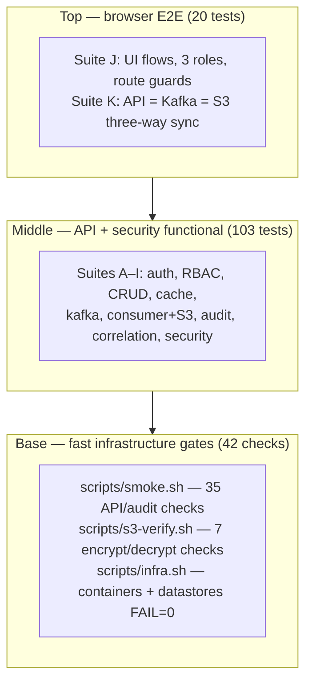

| Command | Scope | Tests |
|---|---|---|
| `npm run test:smoke` | critical path, retries 0, strict gate | 8 |
| `npm run test:functional` | suites A–I (api + security) | 103 |
| `npm run test:e2e` | suites J + K (browser + sync) | 20 |
| `npm run test:regression` | api + security + ui + e2e | 123 |
| `npm run test:all` | full matrix, each file once | **131** |

Notes: no classic unit-test tier today — Maven runs with `-DskipTests`; the shell matrix + API suites occupy that slot (recorded as a gap). No firefox/webkit matrix, no performance tests (explicit non-goals). Test data self-heals: every 5th run `db-flush.sh` resets baseline rows and audit growth.

---

## CI/CD Architecture

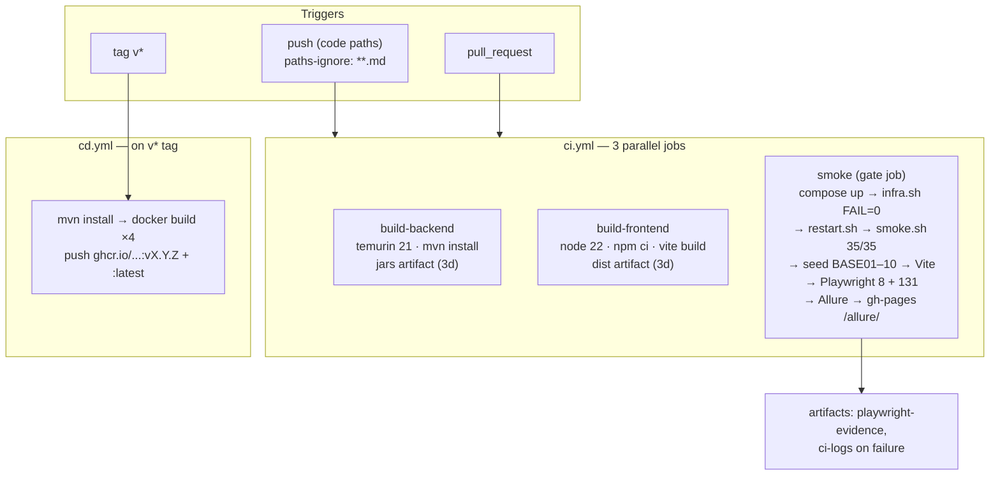

### Delivery stages (evidence)

| Stage | Scope | Gate | Evidence |
|---|---|---|---|
| 1 | Backend jars + frontend dist as artifacts | green run | — |
| 2 | + infra + `smoke.sh` (35 checks) | `FAIL=0` | — |
| 3 | + Playwright 131 + Allure on GitHub Pages | 131/131 | [run 42003197314](https://github.com/Subramanian-Meenakshi/FullStack-Automation-Framework/actions/runs/42003197314) |
| 4 | Hardening: path filters, version bumps | green runs | 05-Nov-2026 |
| 5+ | CD: 4 images → GHCR on `v*` | published | [run 42009784248](https://github.com/Subramanian-Meenakshi/FullStack-Automation-Framework/actions/runs/42009784248), `v0.1.0` |

Design choices worth keeping:

- **One publish job** — Allure publish lives inside `smoke`, sequenced; two jobs pushing `gh-pages` in parallel race on non-fast-forward pushes.
- **Docs-only pushes skip CI** (`paths-ignore: '**.md'`) — README edits do not burn a 10-minute matrix.
- **Concurrency cancel** — newer run on the same ref cancels the superseded one.
- **Failure evidence staged into the workspace** (`ci-logs/`) because `upload-artifact` rejects absolute paths outside the workspace.

---

## Engineering Challenges and How They Were Solved

### 1. Distributed transaction validation

The equality model that anchors the whole suite:

```text
API response  ==  Kafka event payload  ==  decrypted S3 snapshot
     (every field, plus correlationId)
```

Suite K downloads the S3 object with the AWS SDK, decrypts AES-GCM, and field-compares all three representations. A validator self-test proves the comparator itself would catch drift.

### 2. Environment consistency

Everything the tests touch is containerized (Postgres, Redis, Kafka, Kafka UI, LocalStack) and every URL/container/log path is read from `playwright/helpers/services.js` with `process.env.X || localhost default`. Same commands run on a laptop and a GitHub runner — no CI-only shell, no hardcoded machine paths.

Hard-won lesson encoded as a regression: a test once restarted the consumer with a developer-absolute path — green locally, dead on CI. Fix: `REPO_ROOT = path.resolve(__dirname, '../../..')` plus a health assertion after any restart.

### 3. End-to-end traceability

Correlation propagation is treated as a feature with its own suite (H), not a logging nicety. The ID survives six hops and appears in error responses — which turns any incident report into a single grep across services, audit table, and Kafka payloads.

### 4. Degrading gracefully vs. failing loudly

Each external dependency has a defined failure mode: Kafka down → WARN + CRUD green; Redis down → DB fallback; consumer down → UI unaffected; malformed event → `FAILURE` audit, listener alive. Negative tests pin each behaviour so a future refactor cannot silently remove it.

---

## Results

### Platform scale

- **Applications:** 1 React portal, 3 Spring Boot microservices.
- **Infrastructure:** PostgreSQL, Redis, Kafka (KRaft), Kafka UI, LocalStack S3 — all compose-defined.
- **Automation:** 12 spec suites (Smoke + A–K), **131 tests**, 35-check shell smoke matrix, 7 S3 encrypt/decrypt checks, Allure reporting.
- **Delivery:** 3-job CI on every code push; GHCR publish on `v*` tags (live since `v0.1.0`).

### Quality signals

| Signal | Value |
|---|---|
| Full matrix on CI | 131/131, ~9.5 min (job total incl. infra + report) |
| API smoke matrix | 35/35, `FAIL=0` |
| Store-level checks | 7/7 S3 encrypt/decrypt |
| Correlated audit events asserted per run | 8/8 |
| Layers covered per employee write | UI → API → Postgres → Redis → Kafka → consumer → S3 → audit |

---

## Lessons Learned

1. **Hardcoded machine paths are the classic green-local/red-CI bug.** Anything derived from `__dirname` must resolve to the repo root, and backgrounded processes must be health-checked after restart — silent `finally` restarts hide dead services.
2. **CORS belongs on the security filter chain.** MVC-level CORS handles preflight until Spring Security is in the chain; and header-sensitive tests must use `http.request`, not `fetch` (undici forbidden-header behaviour differs across Node patches).
3. **Artifact uploads need workspace-relative paths.** Stage logs into `ci-logs/` first; `upload-artifact` rejects absolute paths outside the workspace.
4. **A registry's first push is flaky by nature.** Pushing a brand-new GHCR package with `GITHUB_TOKEN` intermittently fails at the manifest PUT after layers upload — re-run the job; pre-create packages to avoid it.
5. **Web-editing a stale branch burns a full CI run.** A README-only commit on a branch predating the test fixes executed the whole matrix and went red; merge code branches before editing docs on the mainline.
6. **Pin community infra images deliberately.** LocalStack is frozen at 3.0.2 (newer images require a license token); the pin is a hard rule, documented where people will actually read it.
7. **Docs-only path filters have a visible side effect** — the badge keeps showing the last code run after README edits. Accepted, but worth knowing.
8. **Detached processes need `setsid nohup … < /dev/null & disown`.** Plain `nohup &` dies when the launching shell exits — services vanished between tool calls until this convention was adopted.
9. **Two repositories, one codebase, strict content rules.** The public showcase repo never receives dev docs (`AGENTS.md`, `learning.md`, plan docs, `.opencode/`) and its `.gitignore` stays untouched; pushes happen only from a dedicated worktree. Enforced in `learning.md` so it survives contributor turnover.

---

## Production Readiness Assessment

| Dimension | Present today | Gap before production | Priority |
|---|---|---|---|
| **Identity** | JWT HS384, BCrypt, refresh rotation, RBAC matrix | RS256/OIDC (Keycloak), token revocation list, login rate limiting | P1 |
| **Secrets** | Env-based (`JWT_SECRET`, `S3_DEC_KEY_B64`) | Demo defaults must be overridden; move to Vault/KMS, rotate regularly | **P0** |
| **Transport** | HTTP on localhost | TLS termination at host/gateway | **P0** (with host target) |
| **Data stores** | Single-node compose, volume persistence | Managed Postgres/Redis, backups, retention policy for `audit_logs` | P1 |
| **Messaging** | Auto-created topics, at-least-once listener | DLQ + retry/backoff, partition/retention sizing, schema registry | P1 |
| **Observability** | Correlation IDs, per-service logs, audit table, Allure | Metrics (Prometheus), traces (OpenTelemetry), log aggregation, alerting | P1 |
| **Reliability** | Health gates, graceful degradation, CI concurrency control | Probes + resource limits on a scheduler, PDBs, multi-node | P1 |
| **Security testing** | 131-test matrix incl. STRIDE-mapped suites | DAST scan, dependency CVE gate, secret scanning in CI | P2 |
| **Delivery** | CI + GHCR images, immutable tags | Deploy job to a real host, Helm/K8s, ArgoCD GitOps | P1 |
| **Test depth** | API/security/E2E + shell gates | Unit tier (`mvn test` currently skipped), contract tests (Pact), k6 load | P2 |

**Verdict:** the platform is a **credible pre-production QE baseline** — strong on functional, security, and data-integrity evidence; honest gaps in secrets/transport/observability that are all represented on the roadmap below.

---

## Future Kubernetes / OpenTelemetry Architecture

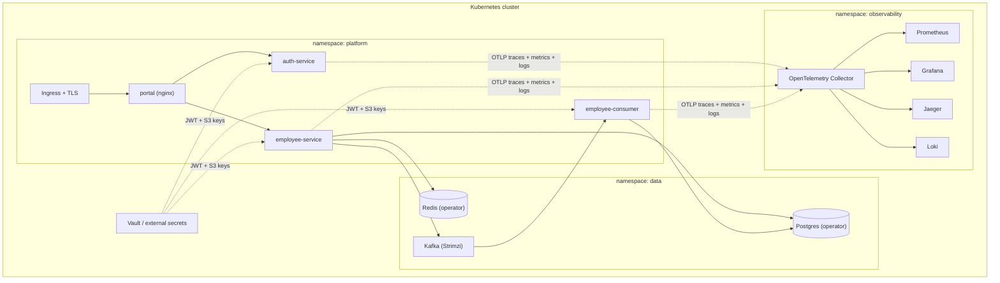

Evolution path (ordered):

1. **Observability** — attach OpenTelemetry SDKs; the existing `X-Correlation-ID` becomes the root trace id; OTel Collector exports to Prometheus/Jaeger/Loki.
2. **Hardening** — Vault-managed secrets, TLS ingress, login rate limiting, DLQ + retries on Kafka.
3. **Scheduling** — Helm charts, health probes, resource limits, HPA on portal/API; Strimzi for Kafka, operators for Postgres/Redis.
4. **GitOps** — ArgoCD syncing from the public repo; environment promotion of the same GHCR images already produced by `cd.yml`.
5. **Advanced QE** — Pact contract tests between services, k6 performance profiles, chaos experiments against the degradation paths the suite already pins, mutation testing on the RBAC/encryption code.

---

## Evidence — Screenshots and Live Artifacts

### React Portal

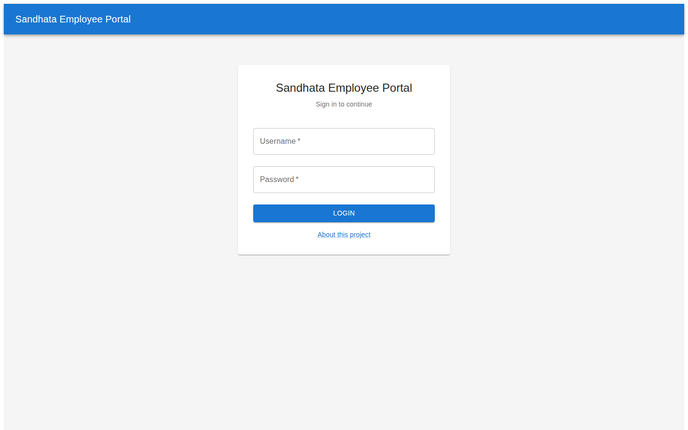

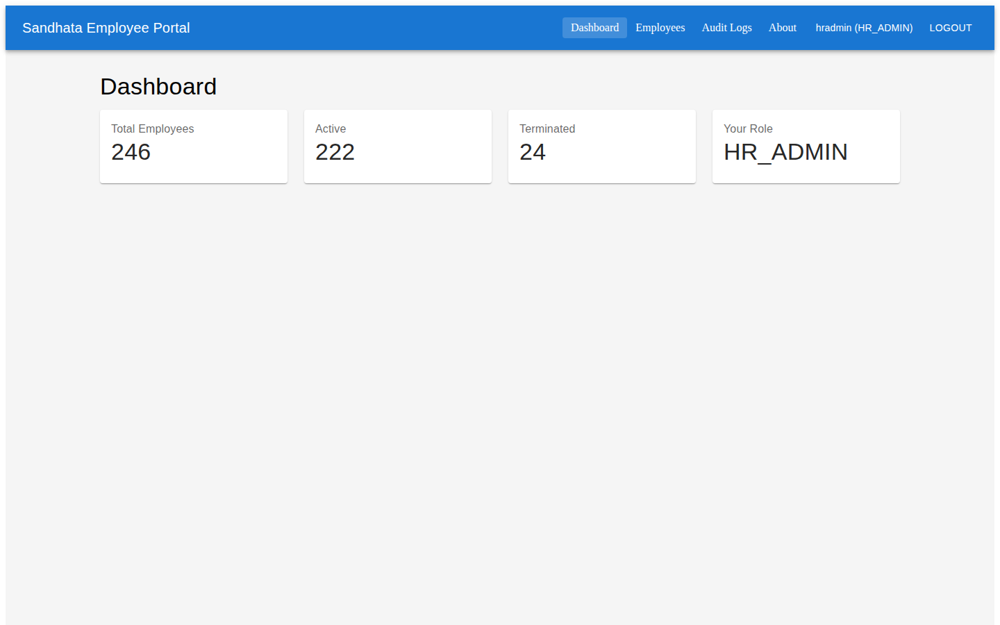

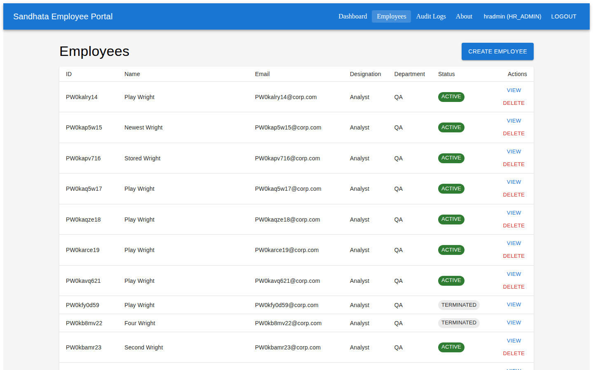

### Kafka UI

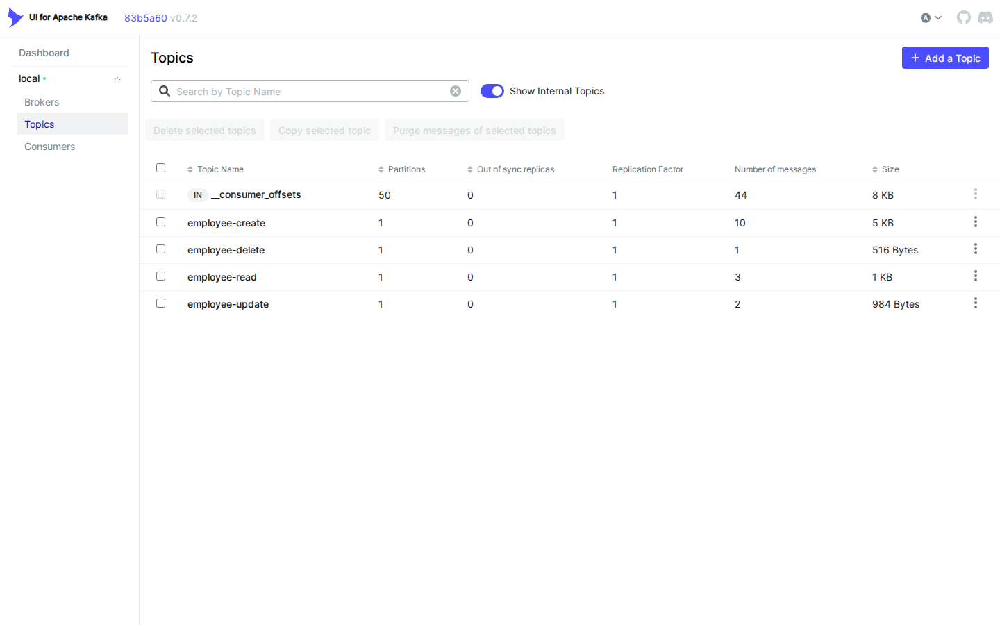

### Allure Dashboard

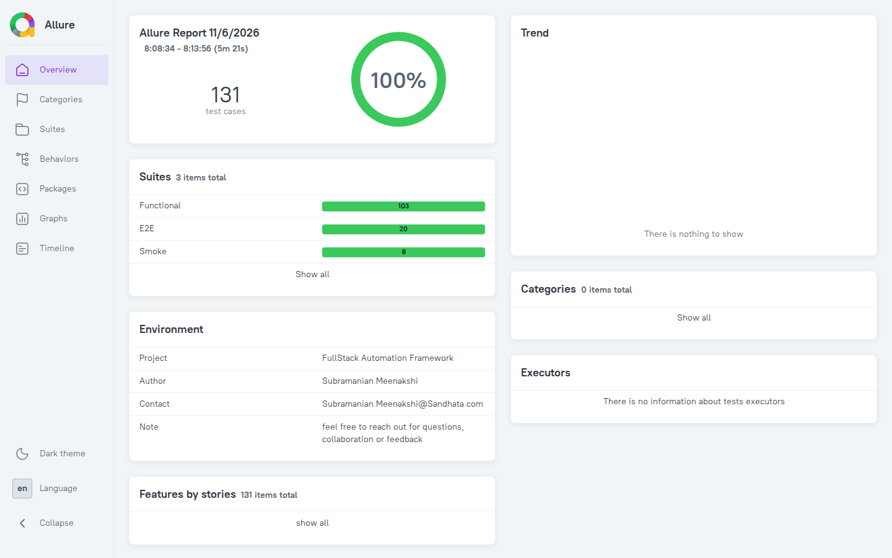

Live report (regenerated on every green CI run): https://subramanian-meenakshi.github.io/FullStack-Automation-Framework/allure/

### GitHub Actions Pipeline

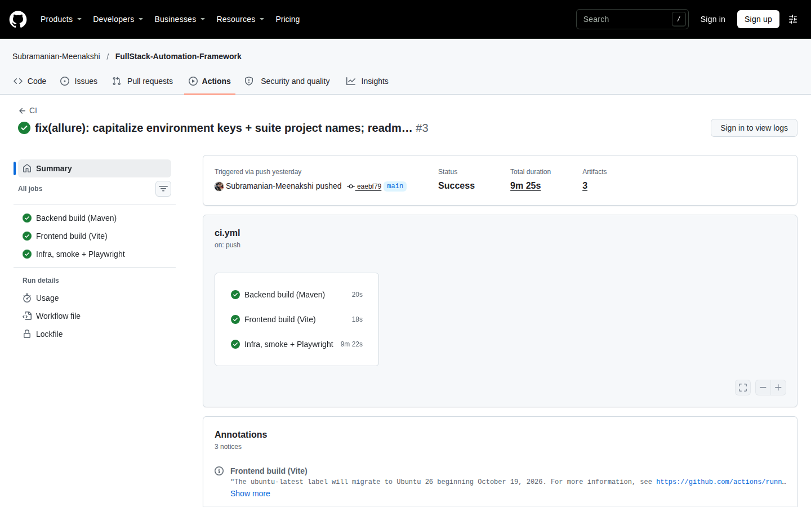

Live pipeline: https://github.com/Subramanian-Meenakshi/FullStack-Automation-Framework/actions

---

## Key Takeaways

This platform demonstrates how Quality Engineering evolves from test automation into **architecture-driven engineering**.

It validates:

- Business transactions across UI, API, and three datastores
- Distributed consistency (API = Kafka = S3 equality)
- Event-driven architecture including failure modes
- Security controls mapped to a STRIDE threat model
- Data integrity (AES-GCM snapshots, correlated audit trail)
- Infrastructure resilience (graceful degradation per dependency)
- CI/CD governance (staged gates, evidence artifacts, immutable image tags)
- End-to-end traceability on a single correlation ID

Rather than testing a single application, the framework validates the behaviour and reliability of an entire cloud-native ecosystem — and every claim in this case study maps to a script you can run or a test that runs on every push.

---

*Run it yourself: see [README §6 Getting started](README.md) — `docker compose up` → `scripts/restart.sh` → `npm run dev`, then `npm run test:all` for the full 131-test matrix.*
